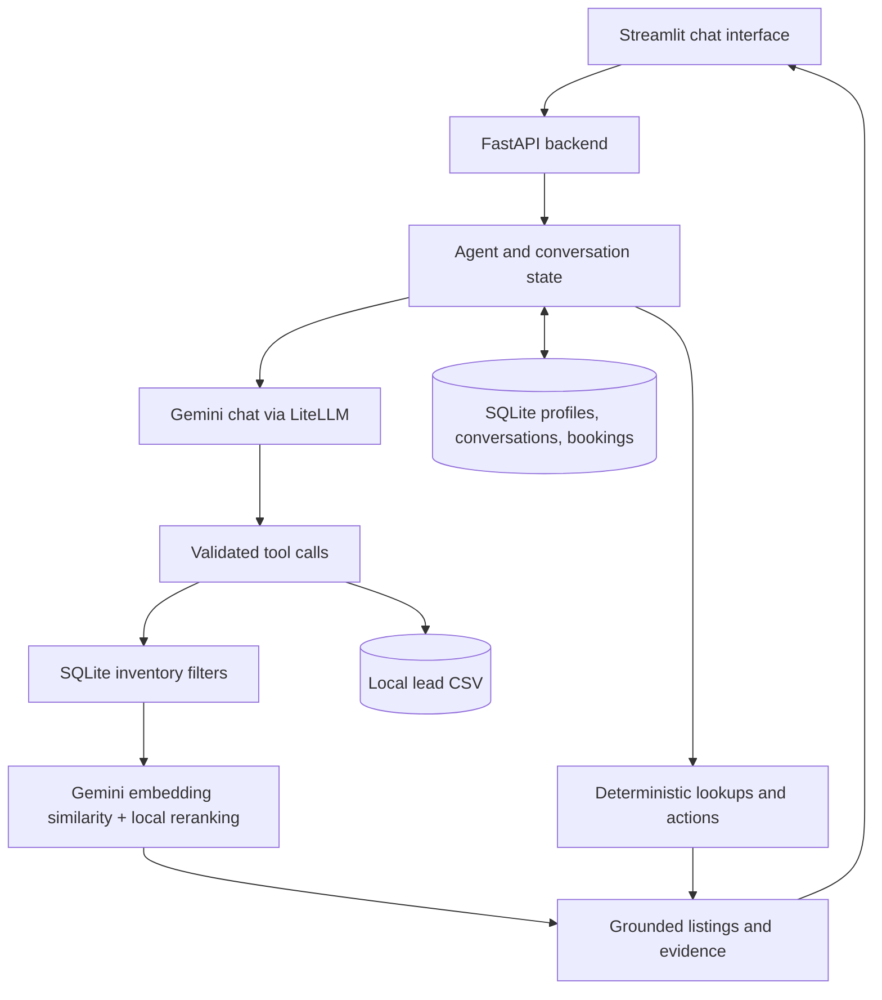

# dubizzle AI Car Shopping Assistant

A local, LLM-powered car-shopping prototype built for the **dubizzle Machine Learning Intern Take-Home Assessment**. Shoppers can describe what they need in natural language, explore grounded recommendations from a supplied inventory, compare listings, arrange simulated viewings, and return to saved preferences. The source is [github.com/renadsameh24/Dubizzle-car-assistant-](https://github.com/renadsameh24/Dubizzle-car-assistant-).

**Core idea:** combine the precision of structured database queries with the flexibility of semantic retrieval, rather than asking an LLM to guess which vehicles satisfy a shopper's requirements.

## Features

- **Natural-language inventory search:** understand needs such as “a reliable everyday car under AED 40k,” including common misspellings and manufacturer-origin requests.
- **Hybrid retrieval and grounded answers:** enforce make, model, year, budget, and mileage limits in SQL; rank eligible listings using Gemini embeddings; use description evidence to explain matches.
- **Honest handling of incomplete data:** display **confirmed matches** separately from **potential matches** whose missing price or mileage prevents verification of a limit.
- **Multi-turn context:** keep relevant search limits and resolve references such as “the first car” and “that Mazda.”
- **Simulated viewings:** check Dubai viewing hours, prevent conflicting slots, and store confirmed bookings.
- **Lead qualification:** record stated budget and customer requirements in a local CSV.
- **Short- and long-term memory:** retain context within a conversation and explicitly saved preferences, liked cars, and bookings across new sessions.
- **Streamlit interface:** chat, loading feedback, original listing photographs, and structured result cards.

## Architecture



### Why hybrid retrieval instead of SQL-only or embedding-only search?

The supplied ads combine **structured fields** (make, model, year, listing ID) with **unstructured descriptions** (“panoramic roof,” “comfortable,” “GCC specs”). Neither retrieval method solves both problems well:

| Approach | Strength | Limitation |
|---|---|---|
| SQL alone | Reliable, exact filters for year, brand, price, and mileage | Cannot naturally rank subjective requests such as “comfortable for my parents” |
| Semantic embeddings alone | Understand related language and rank descriptions by meaning | Similarity is not proof that a car meets a budget or other hard constraint |
| **Hybrid (chosen)** | **SQL first** establishes eligibility; embeddings rank eligible cars for relevance | Quality still depends on what the advertisements actually say |

The backend filters hard requirements *before* applying cosine similarity to cached Gemini embeddings. A lightweight query-aware reranker helps distinguish practical daily-use searches from sporty preferences. An LLM cannot override verified numeric filters. The chat model uses **tool calling** to request searches or actions and uses returned listing facts and relevant advertiser excerpts to produce grounded replies: a practical retrieval-augmented generation (**RAG**) design without an unnecessary vector database for approximately 100 ads.

**Why the other tools?** FastAPI cleanly separates the backend API from the UI; Streamlit supports a fast, inspectable local chat demonstration; LiteLLM provides a common interface for Gemini chat and tool calling; SQLite supports lightweight structured queries and persistent customer state; `uv` makes installation and execution reproducible.

## Inventory and uncertainty

The source of truth is `data/cars.xlsx`, **`cleaned dataset`**, with **100 listings and stable IDs**. The separate `raw dataset` sheet is not silently merged because it does not share the same stable listing identity.

Prices and mileage are conservatively extracted from titles and descriptions; monthly installments, warranty distances, and top speeds are not treated as asking prices or odometer values.

| Availability in the cleaned inventory | Listings |
|---|---:|
| Known sale price | 13 |
| Known mileage | 39 |
| Both known | 12 |
| Missing sale price | 87 |
| Missing mileage | 61 |

Unknown fields remain `NULL`, not zero. When a shopper sets a maximum price, **only vehicles with a known asking price within that limit can be called confirmed matches**. Relevant unpriced vehicles may appear in a **separate, explicitly unconfirmed** section; they are never described as being within budget. The same principle applies to mileage limits. The app can also query and count missing values directly.

Feature evidence comes from the original ad text. It is labeled as an **advertiser claim**, not independent verification of condition, accident history, or equipment. Listing cards use the original `photo_url` when available.

## Conversation state, memory, and actions

**Short-term context** stores the conversation and active search conditions (make, origin, model, year, price, mileage). Changing one condition normally retains the others; an explicit whole-inventory search resets the scope. Named-listing follow-ups fetch that listing directly when possible, rather than invoking another broad semantic search.

**Long-term memory** uses `data/memory.sqlite` to persist explicitly saved preferences, favorites, and bookings. Customers enter the same name to return, then choose to continue an earlier conversation or start an empty one. A new chat does **not** copy old messages, but previously saved information remains accessible. A budget mentioned only as a one-off search constraint is **not automatically** saved as a long-term preference.

> **Prototype privacy limitation:** a typed name is a lookup label, not authentication. Anyone entering the same name can access that local demo profile. Use fictional test customers; production use would require secure identity and access controls.

**Viewing bookings** are simulated, not real dubizzle reservations. The backend checks the `Asia/Dubai` time zone, Monday–Saturday, **08:00–20:00** (hourly starts before 20:00), future dates, and conflicting slots. A booking is confirmed only after SQLite persistence; the assistant can also retrieve and reschedule a saved appointment. Cancellation is not implemented.

**Leads** are written to a local, Git-ignored `leads.csv` when the required customer needs and budget are provided and the save tool succeeds.

## Run locally

These are the commands to go from a new machine to the running page. Use macOS or Linux, in Terminal or Git Bash. Run steps 4 through 10 from the repository root, the folder that contains `pyproject.toml`.

Create a free key at [Google AI Studio](https://aistudio.google.com/apikey) before step 6. Copy the key. It is used only in `.env`.

**1. Install uv** (skip if `uv --version` already prints a version)

macOS or Linux:

```bash
curl -LsSf https://astral.sh/uv/install.sh | sh
source "$HOME/.local/bin/env"
uv --version
```

Windows PowerShell:

```powershell
powershell -ExecutionPolicy ByPass -c "irm https://astral.sh/uv/install.ps1 | iex"
uv --version
```

If `uv` is not found, close the terminal, open a new one, and run `uv --version` again. On Windows, run every command after this in Git Bash.

**2. Install the Python this project pins**

`.python-version` is `3.13`. This downloads it if it is not already installed:

```bash
uv python install 3.13
```

**3. Clone the repository**

The repository is [https://github.com/renadsameh24/Dubizzle-car-assistant-](https://github.com/renadsameh24/Dubizzle-car-assistant-).

```bash
git clone https://github.com/renadsameh24/Dubizzle-car-assistant-.git
cd Dubizzle-car-assistant-
```

**4. Install the locked dependencies**

`uv.lock` is in the repository. This command installs those exact versions, including the test tools, and does not change the lockfile. It needs a network connection the first time.

```bash
uv sync --frozen
```

**5. Create `.env`**

In the command below, replace `YOUR_GOOGLE_AI_STUDIO_KEY` with the key you copied, then run it. Leave the two model lines unchanged. `.env` is gitignored. Do not commit it.

```bash
cat > .env << 'EOF'
GEMINI_API_KEY=YOUR_GOOGLE_AI_STUDIO_KEY
GEMINI_CHAT_MODEL=gemini/gemini-flash-lite-latest
GEMINI_CHAT_FALLBACK=gemini/gemini-3.5-flash-lite
EOF
```

The quotes around `EOF` matter. With those quotes, the shell does not alter the key. Embeddings use `gemini/gemini-embedding-001`. That name is fixed in the code and is not a line in `.env`. If the primary chat model returns 503, 429, a timeout, 404, or 500, the assistant waits at most two seconds and tries the fallback once. 401 and 403 stop.

**6. Start the API and leave this terminal open**

```bash
uv run uvicorn dubizzle_car_assistant.main:app --host 127.0.0.1 --port 8000 --reload
```

**7. In a second terminal, from the same folder, check the API**

```bash
cd Dubizzle-car-assistant-
curl -sS http://127.0.0.1:8000/health
```

The output is `{"status":"ok"}`. Interactive API documentation is at [http://127.0.0.1:8000/docs](http://127.0.0.1:8000/docs).

**8. In that second terminal, start the page and leave it open**

The page calls only `http://127.0.0.1:8000`. A chat turn that calls Gemini can take about a minute. The page waits up to 120 seconds.

```bash
uv run streamlit run app.py --server.address localhost --server.port 8501
```

**9. Open the page**

[http://localhost:8501](http://localhost:8501)

Type a fictional name to start. To come back, type the same name, then continue a saved chat or start an empty one. `data/memory.sqlite` and `leads.csv` are created on this machine and are not in the repository.

**10. Run the tests**

From the repository root, in another terminal. These tests do not call Gemini.

```bash
cd Dubizzle-car-assistant-
uv run pytest -q
```

Stop the API and the page with Ctrl+C in their terminals.

The repository already includes `data/cars.xlsx` and `data/listing_embeddings.npz`. Rebuild the embedding file only if the spreadsheet changes. That command calls the embedding API and needs the key in `.env`:

```bash
uv run python -c "from dubizzle_car_assistant.retrieval.semantic import build_embedding_index; build_embedding_index()"
```

## Demonstration

These are real captures of the local Streamlit application using a fictional demo customer. They document the required **multi-turn interaction** and **cross-session memory**, plus booking and uncertainty handling.

### 1. Grounded multi-turn inventory conversation

The shopper asks for a reliable everyday car under AED 40,000. The reply lists three cars whose sale prices are known and inside that budget.


The confirmed cards use each ad’s photo. The Beetle is 32,000 AED and 36,000 km. The Mazda 3 is 35,000 AED, and its mileage is not listed.


The Camry remains a confirmed match. The Ford Explorer is shown separately because its price and mileage are missing, so it is not treated as inside the budget.


The shopper then asks about the **2019 Mazda 3**. The assistant stays on listing **12**, reports **AED 35,000**, states that mileage is not listed, and attributes condition information to the advertiser.


Asking for that car by name in a later chat loads the same listing directly.


### 2. Explicitly saving a preference

The shopper asks the assistant to save the currently selected Mazda 3; the application stores it as a preference and liked listing.


### 3. Recalling a preference in a new session

A **new conversation** displays the banner that old messages were not copied, but recalls the customer name and the saved **Mazda 3, listing 12**. The assistant correctly does **not** claim to remember the earlier AED 40,000 filter as a saved budget.


### 4. Simulated viewing workflow

The requested 10:00 time is occupied. The assistant lists free hours and saves the same car's viewing at **09:00 on October 31, 2026**.


A separate new conversation retrieves that saved booking, demonstrating persistence beyond a single chat.


### 5. Confirmed versus potential matches

For **Japanese cars from 2019 onward under AED 50,000**, the **Mazda 3 (listing 12, AED 35,000)** is confirmed. Six additional Japanese cars have missing sale prices; relevant ones appear separately as **potential**, *not* confirmed under budget.


## Testing

```bash
uv run pytest -q
```

**Last reported local result: 66 passing tests.** The deterministic suite covers filters, price/mileage null handling, context, typo normalization, description evidence, ordinal references, malformed tool inputs, viewing validation, leads, memory, and error fallbacks. These tests **mock external model calls**; they do not guarantee Google API availability. Real Gemini integrations were also exercised during development, but free-tier service availability may fluctuate.

## Design trade-offs and future work

The prototype deliberately favors **correctness and traceable inventory facts** over a longer list of recommendations. With only 13 known sale prices, strict budgets may produce few confirmed matches; inventing or inferring an asking price from a similar online car would be misleading. The assistant therefore separates potential matches and grounds its feature explanations in actual ad text. Deterministic lookups handle exact facts and saved actions efficiently; the LLM is reserved for open-ended language and selection, with bounded fallback handling if Gemini is unavailable.

Possible next steps toward a production system are **(1) secure automatic returning-customer recognition**, using authenticated accounts or persistent sessions rather than a name alone; **(2) scalable ingestion**, combining conservative regex with validated LLM-assisted extraction for inconsistent new inventory feeds, while keeping source evidence and never inventing missing fields; and **(3) multimodal enrichment**, using Gemini Vision to analyze listing photographs for *apparent* colors or visible attributes, with uncertainty labels rather than claiming verified factory specifications. Live inventory syncing, stronger identity/security controls, and booking cancellation are also outside this prototype's scope.

---

*Developed as a local take-home assessment prototype. Listings, advertiser claims, and simulated bookings are not live marketplace transactions.*
