# dubizzle car assistant

A local prototype that helps a shopper explore a sample dubizzle car inventory in plain language. Hard limits stay exact. Listing photos come from the ads. A returning customer is recognized by the name they type, and the assistant can recall a saved preference and a simulated viewing after the chat is cleared.

The pictures in [Demonstration](#demonstration) are from one local session with the name `jana`. They are the screenshots for this project.

## What the session shows

1. A budget search returns only cars whose listed price is inside the budget, and it separates those from cars whose price is missing.
2. Asking about one car on screen returns that listing’s price, mileage, and an advertiser quote.
3. Saying “save it as my preference” stores the car that is in focus. A new conversation still knows the name and that car. It does not copy the old messages.
4. A budget used as a search filter in one chat is not, by itself, a saved preference. In the new chat, “Do you remember my budget?” has nothing stored to report.
5. Naming the 2019 Mazda 3 opens that listing directly.
6. A viewing at a taken hour lists the open hours. “change to 9:am that day” moves the same car to 09:00. A later question in a new chat reports that saved appointment.

## Features

- Natural-language search over the cleaned listings, with Gemini tool calling for open questions.
- Hybrid retrieval: SQL applies exact filters, then cached embeddings rank the cars that remain.
- Multi-turn limits for make, origin, model, year, price, and mileage. Changing one limit keeps the others. A request for the whole inventory drops them.
- Confirmed matches and potential matches when a price or mileage is missing.
- Advertiser quotes for features the listing text actually states.
- Simulated viewing bookings, checked against Dubai hours, and lead rows in `leads.csv`.
- Persistent memory in SQLite. A new chat does not copy old messages. The name, preferences, liked cars, and bookings stay.
- Listing cards that use each ad’s own photo.
- Direct answers, without a model call, for a named listing, a saved preference, a saved viewing, an open-hours question, and a reschedule that names a new hour.

## How a message is answered

Streamlit sends the message, the session id, and the visitor id to FastAPI. `answer()` checks a few cases before Gemini:

| The shopper says | What happens |
| --- | --- |
| Which hours are still free | The open hours for the car and day already in the conversation are listed from SQLite. |
| Only a listing id, after a time was already named | That listing is booked at the time already named. |
| A question about a booking they already have, in any ordinary wording | The saved appointment is read. Examples: “what car and time do I currently have booked?”, “when is my viewing?”, “which car did I reserve?” |
| A change of time, including “change to 9:am that day” | The saved car and day are kept, and the new hour is written. |
| What they are looking for, or what their name or preference is | The profile is read. The last saved preference is the one reported. |
| Save this car as a preference | The listing currently in focus is stored, together with a liked-car row. |
| One named car, such as “Show me the 2019 Mazda 3” | That listing is loaded from the catalog. Short model names such as “3” count only when the make is in the same sentence. |
| Anything else about the inventory | Gemini may call `search_cars`, `book_viewing`, `save_visitor_memory`, or `save_lead`. |

A booking question is recognized by its shape: it asks what, when, or whether something was booked, and it does not name a new hour. It does not have to match one stored sentence. If a question still reaches the booking tool with no new day or hour, and a booking is already saved, the tool returns that booking. A fresh request such as “Book a viewing”, with no day and no hour, still asks for the time.

Search limits live on the current conversation. They are applied again on the next search in that same chat. They are not written into the long-term preference list. The system prompt tells the model the same thing: call `save_visitor_memory` when the shopper asks to be remembered or names a car they like.

## Search

A **confirmed match** satisfies every hard limit with a known value. If the shopper set a maximum price, the listing must have a sale price at or under that maximum. The same rule applies to mileage.

A **potential match** meets the other limits, but the price or the mileage is null, so the limit cannot be checked. Known values that break a limit are left out of both groups. Potential matches are not described as under the budget. The card says the price or mileage is not listed. Three potential matches are shown at a time. The shopper can ask for more.

“Nothing too expensive”, with no number, still applies a listed-price cap of 50,000 AED. The shopper can ask for confirmed prices only, and the potential group is then hidden.

Ranking after the SQL filter is deterministic. The shopper’s stated price wins over a price the model suggests. A reply that names a listing id or a make that is not in the cards for that turn is discarded, and the shopper is asked to try the question again. The same replacement happens if the reply says potential cars are under the budget.

Follow-ups stay inside the current filters. “Show me Japanese cars from 2019 onwards under 50,000 AED” and then a different topic in that same chat still carries those limits, unless the shopper asks for the whole inventory or names one car. A new chat starts with an empty search state.

Feature evidence is a quote from that advertisement, prefixed as an advertiser claim. “No repair” in an ad is not treated as accident-free. Chassis numbers, phone numbers, and dealer boilerplate are left out of the quote.

Common make typos and plural makes are normalized. Counts, the cheapest listed car, and other inventory statistics are answered from SQL.

## Memory

The page has two steps before the chat. A new customer types a name. A returning customer types the same name, then continues a saved chat or starts an empty one. The welcome line is “Come back later by typing this name.” The name is a label for this local demonstration. Anyone who types it opens that profile. The page does not use cookies or a password. Two people cannot save the same name. The placeholder “Visitor” is ignored.

SQLite (`data/memory.sqlite`) stores:

- the visitor id and the typed name
- preference notes the shopper asked to save
- liked listing ids
- conversations and their messages
- the search state for each conversation, including the focused listing id
- bookings

A new conversation shows “Older messages were not copied here.” The profile is still loaded. “What kind of car was I looking for?” is answered from that profile: the name, the latest preference note, and the liked cars.

In the `jana` session, “i wanna save it as my preference” stored “the 2019 Mazda 3 (listing 12)” and liked listing 12. The next conversation reports that. The earlier sentence “under 40,000 AED” had been a filter on the first conversation. It was not saved as a preference note, so “Do you remember my budget?” in the new conversation has no budget figure to return. A lead row, when one is written, goes to `leads.csv` and is also separate from the preference list.

## Bookings

Viewings are simulated. They are not sent to a dubizzle branch. Hours are Monday to Saturday, from 08:00 up to but not including 20:00, in Asia/Dubai. Sunday is closed. A time that has already passed is rejected with that timestamp. “Next Saturday at 9 AM” is resolved from the shopper’s words against the current Dubai time. “9:am” is read as 09:00.

A slot is unique per listing and time. If that hour is taken, the reply names the slot and lists the hours from 08:00 through 19:00 that are still free. In the session, Saturday 31 October 2026 at 10:00 was already taken for listing 12. The open hours that day were 08:00, 09:00, 13:00, 15:00, 16:00, 17:00, 18:00, and 19:00. “change to 9:am that day” booked the 2019 Mazda 3 at 2026-10-31 09:00. A later new conversation, asked “What car and time do I currently have booked?”, returned that same row.

The confirmation is written to SQLite before the assistant may say the viewing is booked. Bookings saved before a customer name existed have a null `user_id` and are not attached to a later visitor. Several bookings for one visitor are listed, and a change asks which one when more than one could match. The assistant cannot cancel a booking.

## Leads

When the shopper states both a maximum budget and what they need, the model is instructed to call `save_lead`. The row is appended to `leads.csv` with the time, visitor id, name, budget, and need. The assistant may say a lead was saved only when that tool returns `saved: true`. `leads.csv` is gitignored.

## Architecture

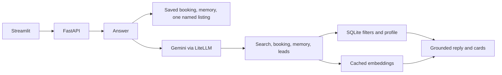

Streamlit is the client because this assessment only needs a local chat page: messages, photo cards, and a return-by-name flow, without a separate frontend build. Gemini is called through LiteLLM so tool calling stays in one loop. SQLite stores profiles, chats, search limits, and bookings on disk, so they are still there after the API restarts. A vector database would not change the result for about 100 ads.

SQL enforces exact constraints because a budget, year, or make must not be overruled by a similar description. Semantic similarity then ranks the cars that survived those filters. Dealer descriptions share words such as “comfort”, so similarity alone often ranks the same cars. A small local adjustment uses the current question to separate an everyday request from a sports-car request without a new embedding model.

The HTTP status stays 200 when the model is busy. The JSON field `answered` is false for the busy reply and for the “couldn’t complete that” reply. Streamlit shows an error state on the status line in those cases. A successful HTTP response is not treated as a successful answer.

## Data handling

The primary inventory is the cleaned sheet in `data/cars.xlsx`: 100 listings. Thirteen have a known sale price and 39 have a known mileage. Twelve have both. Missing values stay null. Monthly payments, warranty distances, and top speeds are not treated as a sale price or an odometer reading.

Listing 12, which the session keeps returning to, is the 2019 Mazda 3 at 35,000 AED with no mileage listed. Listing 60 is the 2019 Volkswagen Beetle at 32,000 AED and 36,000 km. Listing 61 is the 2018 Toyota Camry at 36,999 AED and 169,859 km. Listing 1, the 2013 Ford Explorer, has neither price nor mileage, so a budget search can only offer it as a potential match.

The cached embedding file is `data/listing_embeddings.npz`: 100 vectors of length 3072, keyed by listing id. A reviewer can rank cars without embedding the catalog again. Each new open question still embeds that question once.

## Setup

Install [uv](https://docs.astral.sh/uv/). Python 3.13 is pinned in `.python-version`. From this folder:

```bash
uv sync
cp .env.example .env
```

Put a [Google AI Studio](https://aistudio.google.com/apikey) key in `.env`. The free tier is enough. `.env.example` contains only placeholders:

```bash
GEMINI_API_KEY=your_key_here
GEMINI_CHAT_MODEL=gemini/gemini-flash-lite-latest
GEMINI_CHAT_FALLBACK=gemini/gemini-3.5-flash-lite
```

The chat model defaults to `gemini/gemini-flash-lite-latest`. `gemini-3.1-flash-lite` returns HTTP 503 under load, and `gemini-2.5-flash` is no longer available to new API keys. If the primary model returns 503, 429, a timeout, 404, or 500, the assistant waits at most two seconds and tries the fallback once. 401 and 403 stop. Embeddings stay on `gemini/gemini-embedding-001`. Logs record the model, the elapsed time, and a scrubbed error. API keys are redacted.

Rebuild the embedding file only if `data/cars.xlsx` changes:

```bash
uv run python -c "from dubizzle_car_assistant.retrieval.semantic import build_embedding_index; build_embedding_index()"
```

## Run

Start the API:

```bash
uv run uvicorn dubizzle_car_assistant.main:app --reload
```

In a second terminal, start the page. It calls the API at `http://127.0.0.1:8000`. The chat request timeout on the page is 120 seconds, because a tool-calling turn can take longer than a single completion.

```bash
uv run streamlit run app.py
```

Open the local URL Streamlit prints, usually `http://localhost:8501`.

## Design decisions

- Exact facts are read from SQLite or the spreadsheet before the model is asked. A price, a mileage, a saved name, and a booked hour are the kind of answer a paraphrase should not be allowed to invent.
- The model is used for open search: “a reliable car for everyday driving”, “Japanese cars from 2019”. The tools constrain what it can claim.
- Confirmed and potential matches are separate because most of this catalog has no sale price. Treating a missing price as “inside the budget” would be false.
- Search state is per conversation. Long-term memory is only what the shopper asked to save, plus bookings tied to the visitor id. That is why a new chat remembers the Mazda 3 and does not remember the 40,000 AED filter from the previous chat.
- The typed name is enough for a local demo and is the wrong mechanism for a real account. Cookies and login were left out on purpose.
- One free-tier chat model, plus one named fallback, avoids spending a call on a model that is returning 503. The embedding model is unchanged so the cached vectors stay valid.

## Out of scope

These are future enhancements, not part of this prototype:

1. Secure automatic returning-customer recognition, instead of a typed name.
2. Scalable LLM-assisted structured extraction for a new dataset, alongside the current conservative parsing.
3. Gemini Vision for visual attributes such as vehicle color.

Also out of scope: cancelling a booking, estimating a missing price or mileage, watching the live dubizzle site, and recommending another marketplace. Questions that are not about buying, viewing, or comparing cars are declined.

A wording that never mentions a booking, a viewing, or an appointment can still be sent to Gemini. Unusual memory questions that do not look like “what am I looking for” or “what is my preference” can also be sent to the model. The budget question in the screenshots is an example: it was answered by the model from the profile it was given, and that profile had no budget note.

## Demonstration

The shopper is `jana` on the local page. The API and Streamlit were already running. These are the captures from that session, in order.

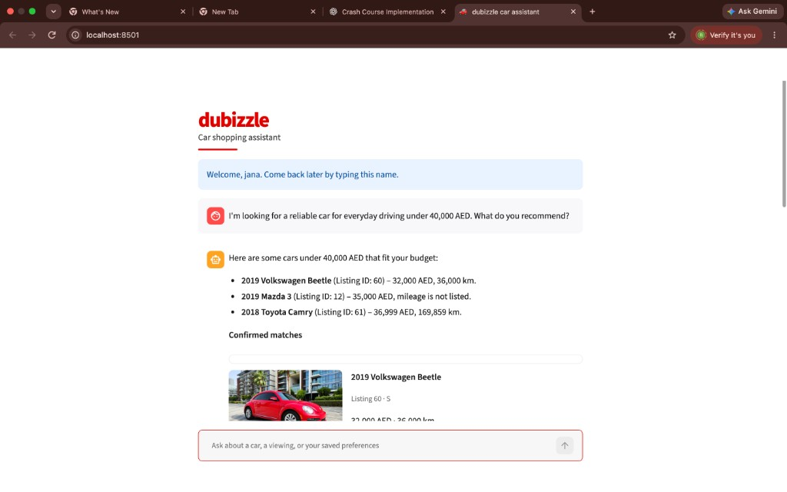

*The three cars all have a listed price at or under 40,000 AED: 32,000, 35,000, and 36,999. The Mazda mileage is reported as not listed.*

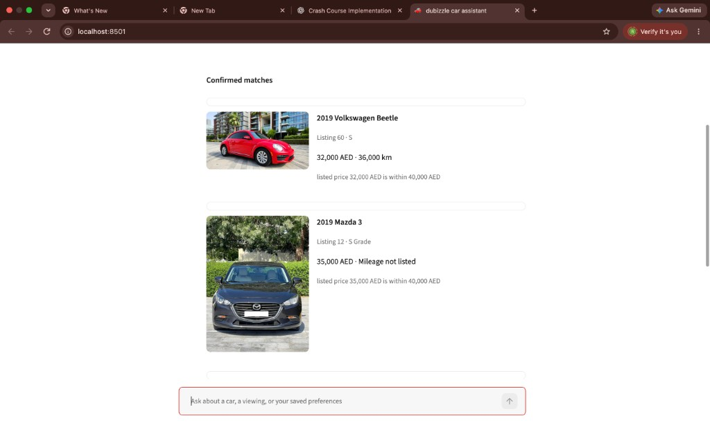

*Each card uses the listing photo. The Beetle shows 32,000 AED and 36,000 km. The Mazda 3 shows 35,000 AED and mileage not listed. Both cards say the listed price is within 40,000 AED.*

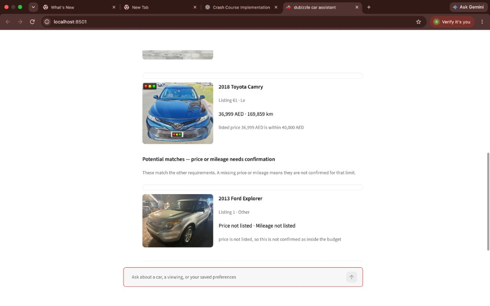

*The Camry is still a confirmed match at 36,999 AED. The Explorer is under “Potential matches” because the price is missing, and the card says it is not confirmed as inside the budget.*

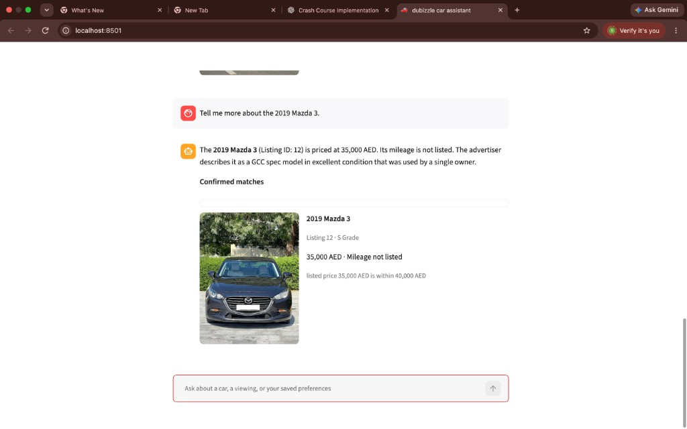

*The follow-up stays on listing 12. The description is quoted as the advertiser’s wording: a GCC spec model in excellent condition, used by a single owner.*

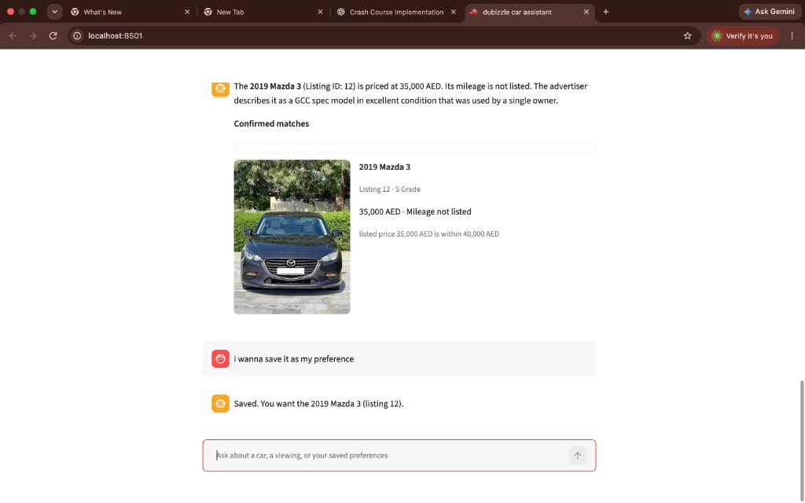

*The car in focus is stored as the preference and as a liked listing. This does not depend on the model paraphrasing the confirmation.*

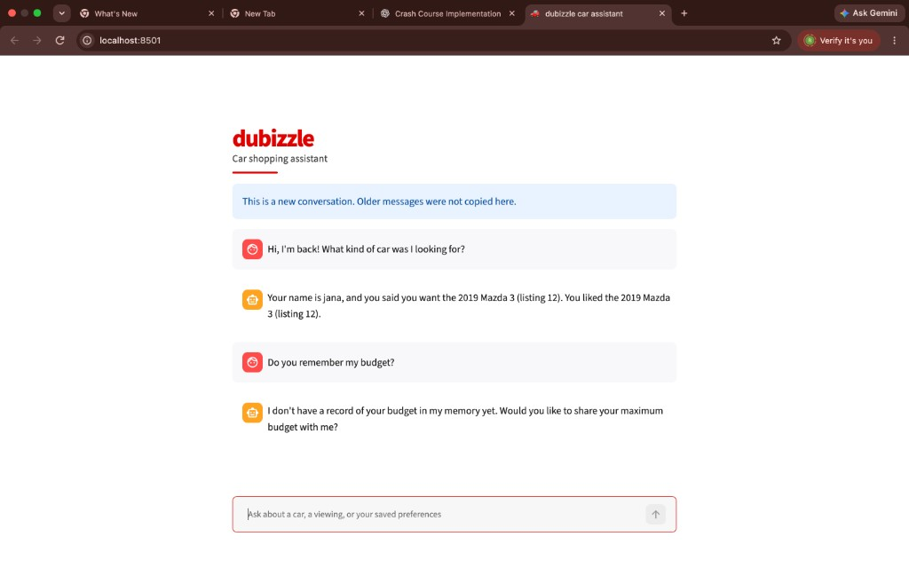

*The banner says older messages were not copied. The saved preference survived. The 40,000 AED figure from the first chat was a search limit, not a saved preference, so the budget question has no stored number.*

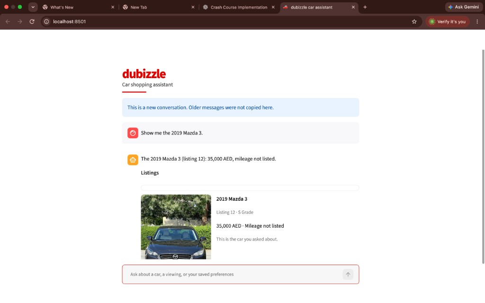

*The short model name “3” is resolved because “Mazda” is in the same sentence. The card says this is the car that was asked about.*

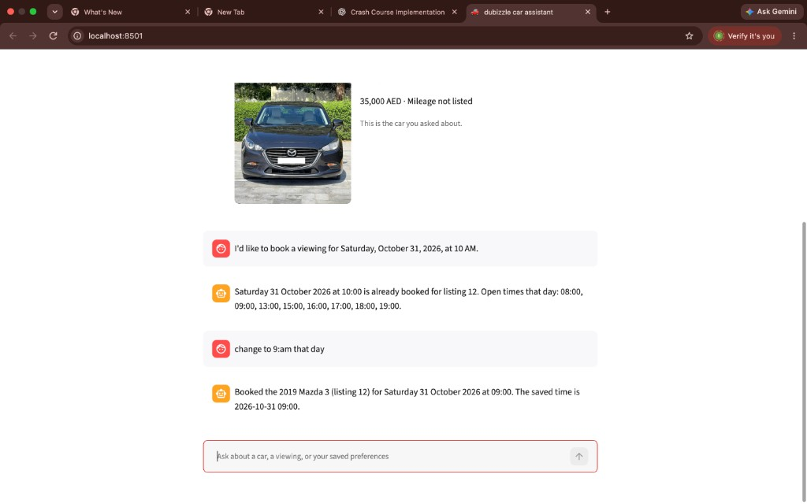

*The 10:00 reply lists the open hours. The 09:00 reply names the 2019 Mazda 3 and the saved timestamp 2026-10-31 09:00.*

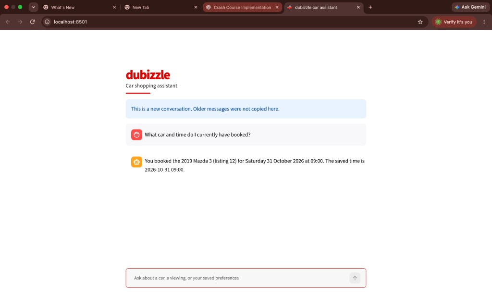

*The booking is stored on the visitor, so the empty conversation can still read it. The saved time in the reply is 2026-10-31 09:00.*

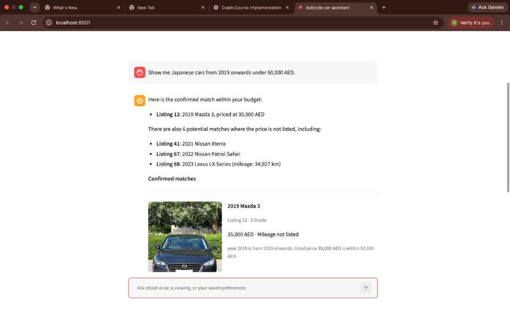

*The reply says there are six potential matches and lists three of them: a 2021 Nissan Xterra, a 2022 Nissan Patrol Safari, and a 2023 Lexus LX-Series. They are not described as under the budget.*

## Testing

```bash
uv run pytest
```

The default suite does not call Gemini. **66 tests passed.** They cover budgets, confirmed and potential matches, missing prices and mileage, typos and amounts such as `40k`, search limits that carry or drop across messages, ordinal references, description evidence, the Mazda 3 lookup, empty results, malformed tool arguments, viewing hours, open hours, rescheduling, booking questions in more than one wording, leads, returning visitors, saved preferences, and a busy-model reply.
