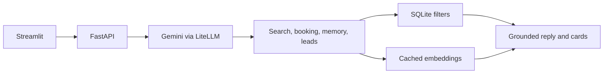
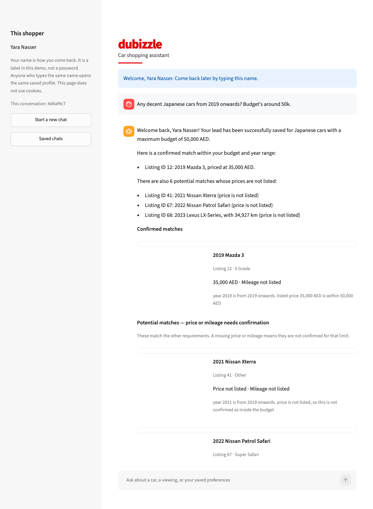
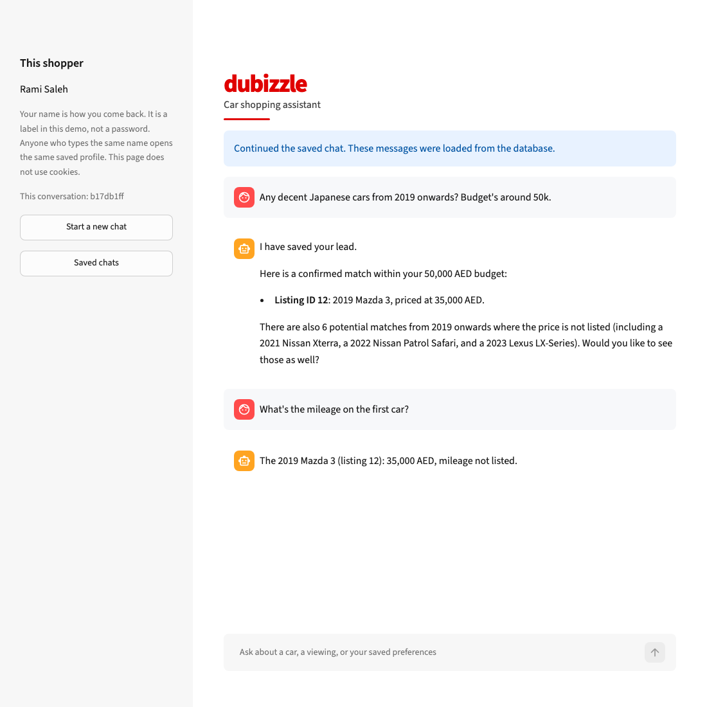
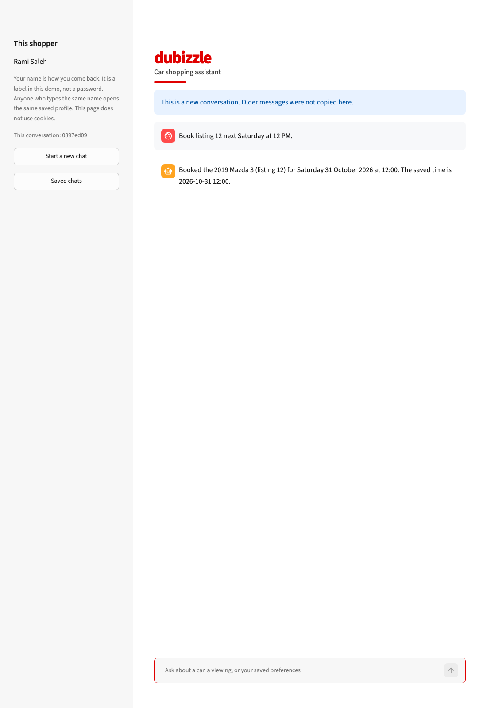
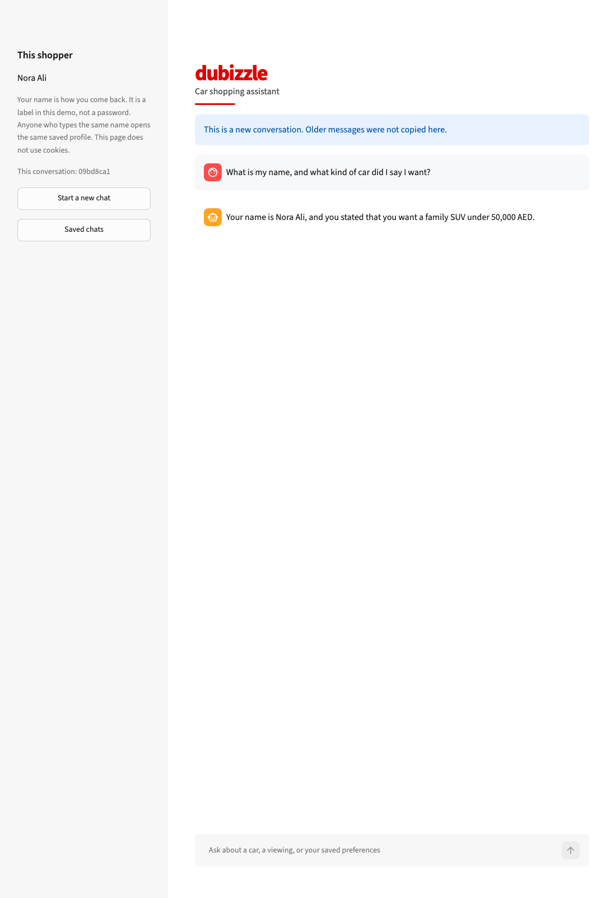

# dubizzle car assistant

A local prototype that helps a shopper explore a sample dubizzle car inventory in plain language. It keeps hard limits exact, shows the listing photos, and remembers a returning customer’s name, preferences, and simulated viewings.

## Features

- Natural-language search over the cleaned listings, with Gemini tool calling.
- Hybrid retrieval: SQL applies exact filters, then cached embeddings rank the cars that remain.
- Multi-turn limits for make, origin, model, year, price, and mileage. Changing one limit keeps the others. A request for the whole inventory drops them.
- Confirmed matches and potential matches when a price or mileage is missing.
- Advertiser quotes for features the listing text actually states.
- Simulated viewing bookings, checked against Dubai hours, and lead rows in `leads.csv`.
- Persistent memory in SQLite. A new chat does not copy old messages. The name, preferences, liked cars, and bookings stay.
- Listing cards that use each ad’s own photo.

## Architecture



Streamlit sends each turn to FastAPI. The agent may call `search_cars`, `book_viewing`, `save_visitor_memory`, or `save_lead`. Search runs the SQL filters first. Embeddings rank only the rows that pass. The reply and the cards come from that same result. A reply that names a car outside the result is replaced.

## Technical decisions

Streamlit is the client because this assessment only needs a local chat page: messages, photo cards, and a return-by-name flow, without a separate frontend build. Gemini is called through LiteLLM so tool calling stays in one loop. SQLite stores profiles, chats, search limits, and bookings on disk, so they are still there after the API restarts. A vector database would not change the result for about 100 ads.

SQL enforces exact constraints because a budget, year, or make must not be overruled by a similar description. Semantic similarity then ranks the cars that survived those filters. Dealer descriptions share words such as “comfort”, so similarity alone often ranks the same cars. A small local adjustment uses the current question to separate an everyday request from a sports-car request without a new embedding model.

## Data handling

The primary inventory is the cleaned sheet in `data/cars.xlsx`: 100 listings. Thirteen have a known sale price and 39 have a known mileage. Twelve have both. Missing values stay null. Monthly payments, warranty distances, and top speeds are not treated as a sale price or an odometer reading.

A **confirmed match** satisfies every hard limit with a known value. A **potential match** meets the other limits, but a missing price or mileage means it cannot be confirmed. Potential matches are not described as under the budget. A request for confirmed prices only hides them. The page shows a few potential matches, and the shopper can ask for more.

A feature such as a panoramic roof is quoted only when that listing’s text states it. The card labels the sentence as an advertiser claim. Chassis numbers, phone numbers, and dealer boilerplate are left out of the quote. The claim is not an independently verified specification.

## Setup

Install [uv](https://docs.astral.sh/uv/). Python 3.13 is pinned in `.python-version`. From this folder:

```bash
uv sync
cp .env.example .env
```

Put a [Google AI Studio](https://aistudio.google.com/apikey) key in `.env`. The free tier is enough. `.env.example` contains only placeholders:

```bash
GEMINI_API_KEY=your_key_here
GEMINI_CHAT_MODEL=gemini/gemini-flash-lite-latest
GEMINI_CHAT_FALLBACK=gemini/gemini-3.5-flash-lite
```

The chat model defaults to `gemini-flash-lite-latest`. `gemini-3.1-flash-lite` currently returns HTTP 503 because of demand, and `gemini-2.5-flash` is no longer available to new API keys. If the primary model is unavailable, the assistant tries the fallback once. Embeddings stay on `gemini-embedding-001`.

Listing embeddings are already in `data/listing_embeddings.npz` (100 vectors). A reviewer can rank cars without embedding the catalog again. Each new question still embeds that question once. Rebuild the file only if `data/cars.xlsx` changes:

```bash
uv run python -c "from dubizzle_car_assistant.retrieval.semantic import build_embedding_index; build_embedding_index()"
```

## Run

Start the API:

```bash
uv run uvicorn dubizzle_car_assistant.main:app --reload
```

In a second terminal, start the page. It calls the API at `http://127.0.0.1:8000`.

```bash
uv run streamlit run app.py
```

Open the local URL Streamlit prints, usually `http://localhost:8501`.

A new customer types a name. A returning customer types the same name, then continues a saved chat or starts an empty one. The name is a label for this local demonstration, not secure authentication: anyone who types it opens that profile. The page does not use cookies. Two people cannot save the same name. Qualified leads are appended to `leads.csv`. Neither `leads.csv` nor `data/memory.sqlite` is committed.

Viewings are simulated. They are not sent to a dubizzle branch. Hours are Monday to Saturday, from 08:00 up to but not including 20:00, in Asia/Dubai, and only for a time that has not passed. “Next Saturday at 9 AM” is resolved from the shopper’s words. A booking is written before the assistant may say it is booked.

## Design and limitations

Search limits belong to the current conversation. They are not copied into the long-term preference list. The last preference the shopper asked to remember is the one a later session should follow. Questions such as how many cars have both a price and a mileage, and comparisons such as the cheapest listed car, are answered from SQL. A busy model call is retried briefly. If it still fails, the page asks the shopper to try again and does not invent a car.

Most listings have no sale price, so a budget search is short on purpose. The assistant cannot cancel a booking, estimate a market price, or watch the live dubizzle site. Bookings saved before a customer name was stored have a null `user_id` and are not attached to anyone.

These are future enhancements, not part of this prototype:

1. Secure automatic returning-customer recognition, instead of a typed name.
2. Scalable LLM-assisted structured extraction for a new dataset, alongside the current conservative parsing.
3. Gemini Vision for visual attributes such as vehicle color.

## Demonstration

The shopper in these pictures is a fictional demo profile.



*Confirmed matches are cars whose listed price meets the budget. Potential matches fit the other limits, but their price is not listed, so they are not treated as under budget.*



*The follow-up stays on the first retrieved car, the 2019 Mazda 3, and reports that the mileage is not listed.*



*The confirmation names the listing and the saved time. The appointment exists only in the local database.*



*After the page is reloaded, the same name opens a new empty conversation and the assistant still recalls the saved name and preference.*

## Testing

```bash
uv run pytest
```

The default suite does not call Gemini. **59 tests passed.** They cover budgets, confirmed and potential matches, missing prices and mileage, typos and amounts such as `40k`, search limits that carry or drop across messages, ordinal references, description evidence, empty results, malformed tool arguments, viewing hours, bookings, leads, returning visitors, and a busy-model reply.
